# Screenshots

Last-updated: 2026-10-24

Thirteen captures of the current production Vue interface, including the
**Printers** label, **Cameras** view, **Camera feed** selector, playback badges,
camera settings, large file preview and **Smart plugs** (list, settings, power-off
confirmation and the offline printer view with plug controls).

These screenshots use sanitized sample printer/camera status, filenames,
documentation-network addresses and illustrated media. The camera scene is
explicitly labeled as simulated; its H.264 frames pass through the real
WebCodecs player before capture. The images illustrate the UI and do not
establish live hardware, firmware availability or native-OS qualification.
See [desktop usage](desktop.md) and [IP cameras](ip-cameras.md) for behavior.

Capture settings: dark theme, English, UTC, 1600×1100 CSS viewport at 2× pixel
scale, full-page PNG. Native title bars and browser chrome are excluded.
[The capture manifest](../screenshots/capture-manifest.json) records the source
commit/hash, sample fixture hash, actual capture time, fixed scenario time,
image dimensions and checksums.

## Printers

Fleet overview: total, online, and printing counts, plus per-printer status,
model, host, and quick actions.

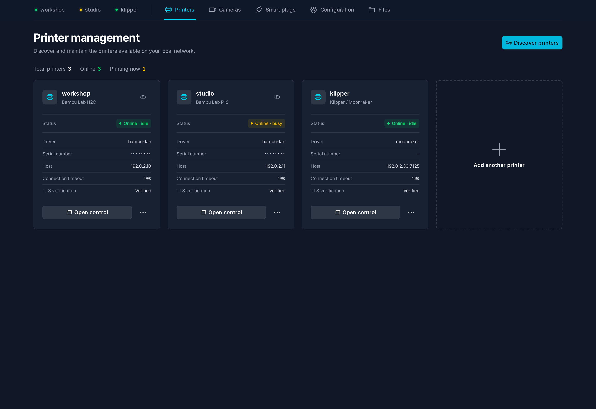

## Configuration

Notifications, firmware sources, registered slicer applications, material
presets, appearance, and version/license information.

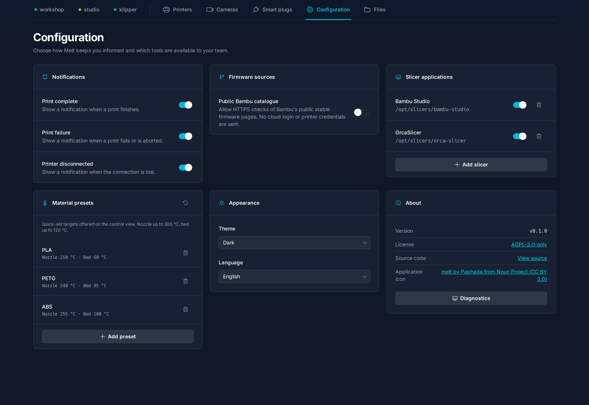

## File library

Browsing a directory of model files with size and modified date, ready to
organize, slice, or print.

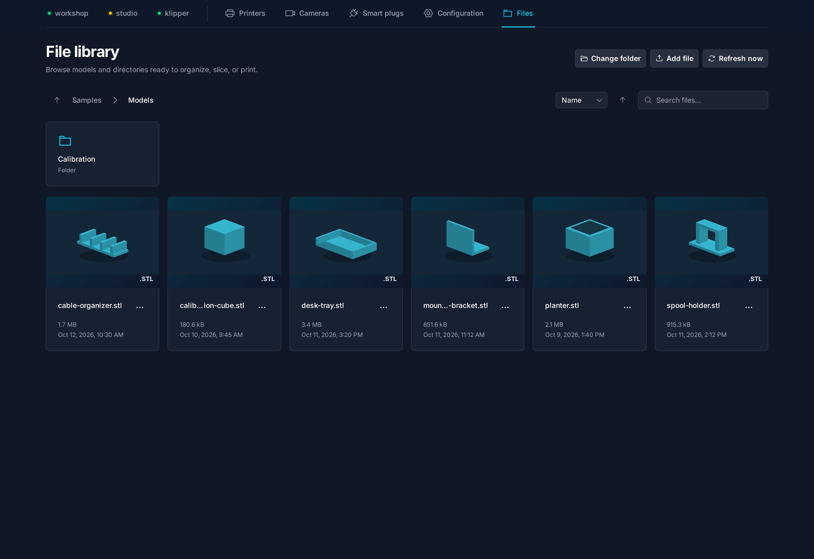

## File preview

The large preview dialog keeps the file's metadata and print/slicer/delete
actions together. This capture uses an illustrated sample model preview.

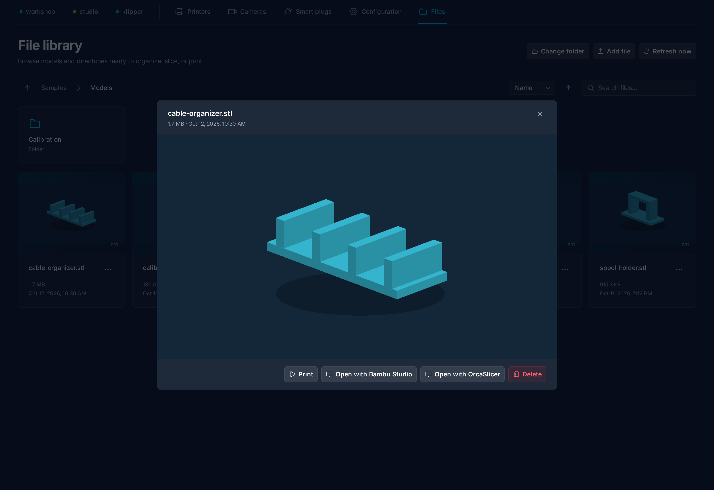

## Firmware & software

Per-printer comparison of installed module versions against printer-advertised,
device-catalogue, and public-stable evidence.

The assessment distinguishes a newer public stable release from an update
confirmed by the printer; a public release is not an actual release offer.

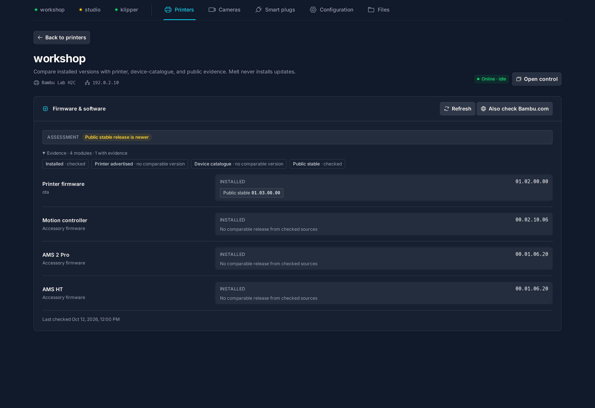

## Printer control — idle

Camera, current job, temperatures, fans, lights, motion controls, printer
files, and AMS/material systems for an idle printer.

The camera card includes the built-in/external feed picker and the H.264
playback badge. The sample also shows active AMS HT drying telemetry.

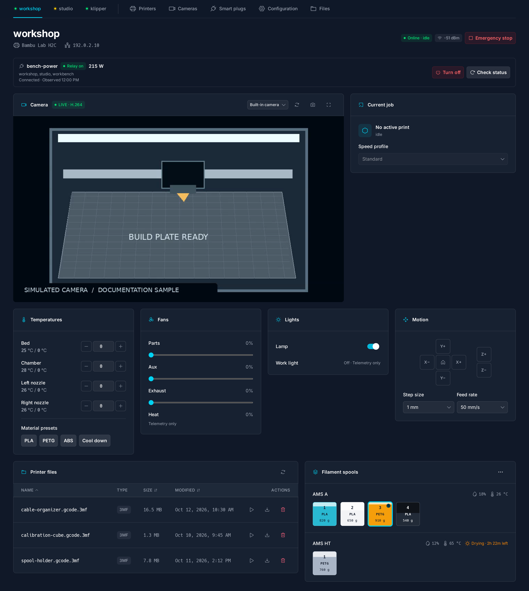

## Printer control — printing

The same control view mid-print, with job progress, layer count, time
remaining, and live AMS slot assignments.

The job is the sample Cable organizer, plate 1 of 2. Busy-state explanations
remain visible above locked temperatures and motion controls.

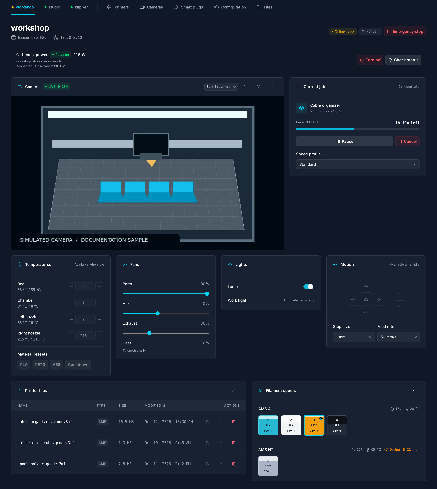

## Cameras

Independent camera profiles, linked printers, per-viewer High/Low quality,
and the active H.264 playback badge.

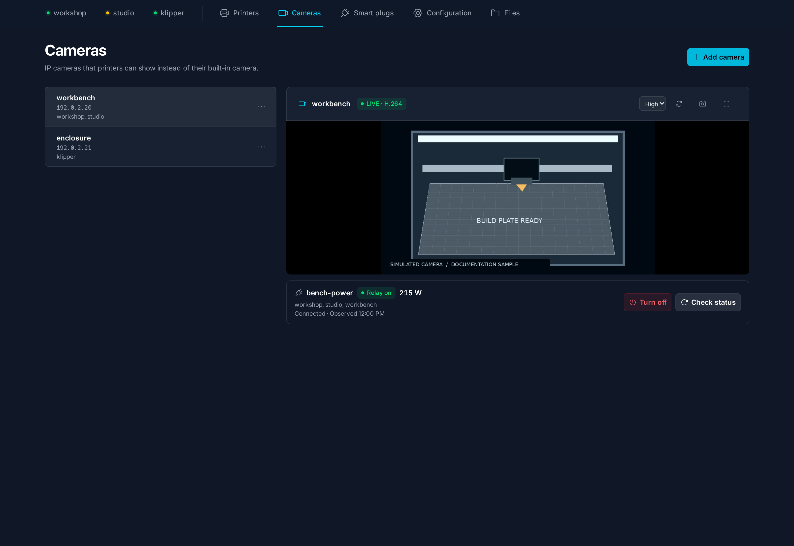

## Camera settings

Editing an existing profile shows the connection details, a blank password
field that retains the saved password, and the linked-printer checkboxes.
The sample contains no camera password or real credentials.

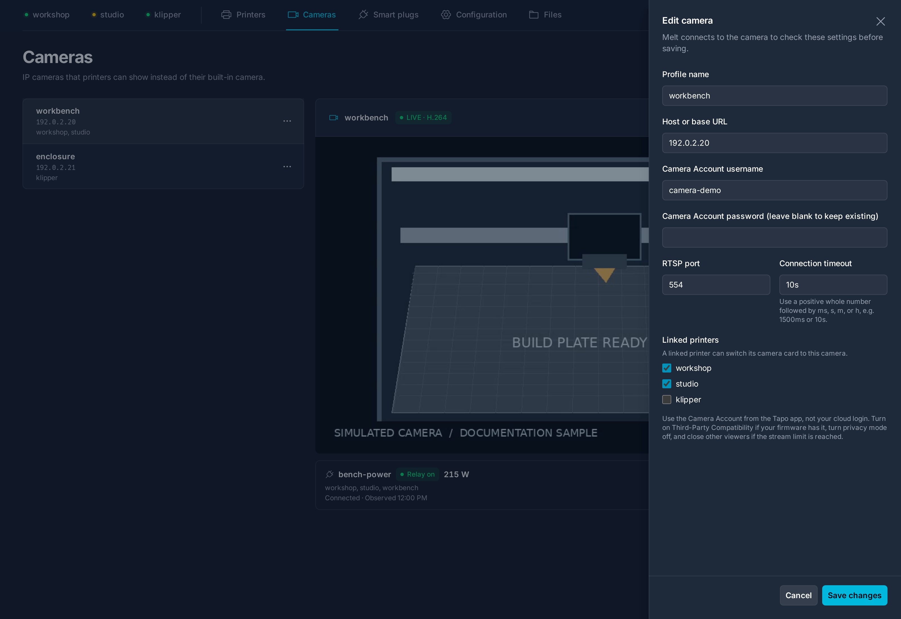

## Printer control — offline

An unreachable printer keeps its smart plug controls so power can be restored.

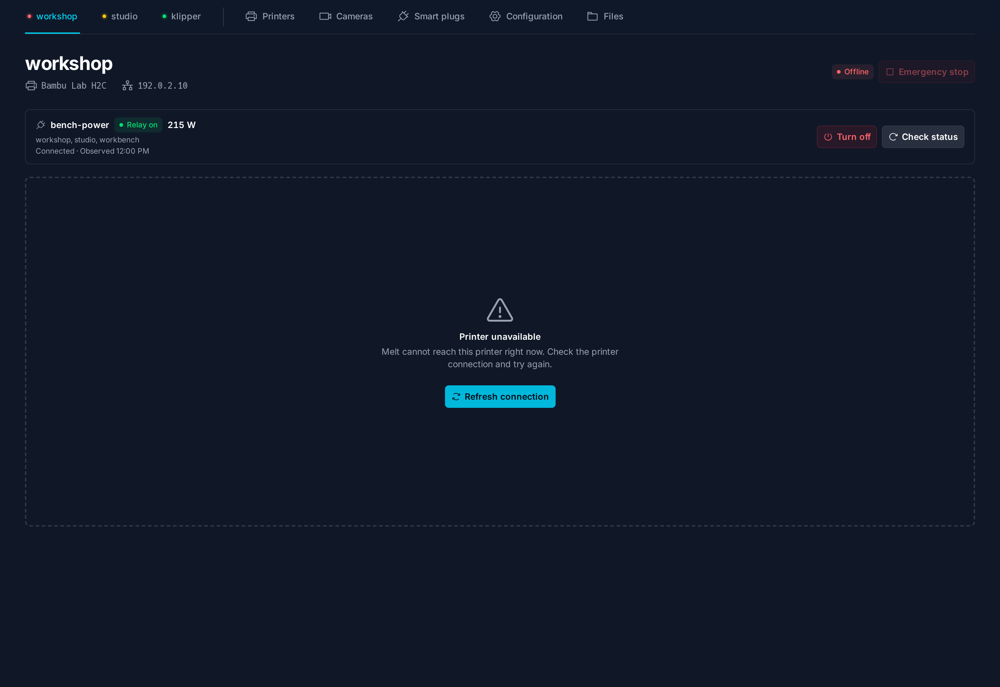

## Smart plugs

Sample plugs cover relay on with power, relay off, unreachable (last known
state shown as stale), sign-in failed and unattached plugs.

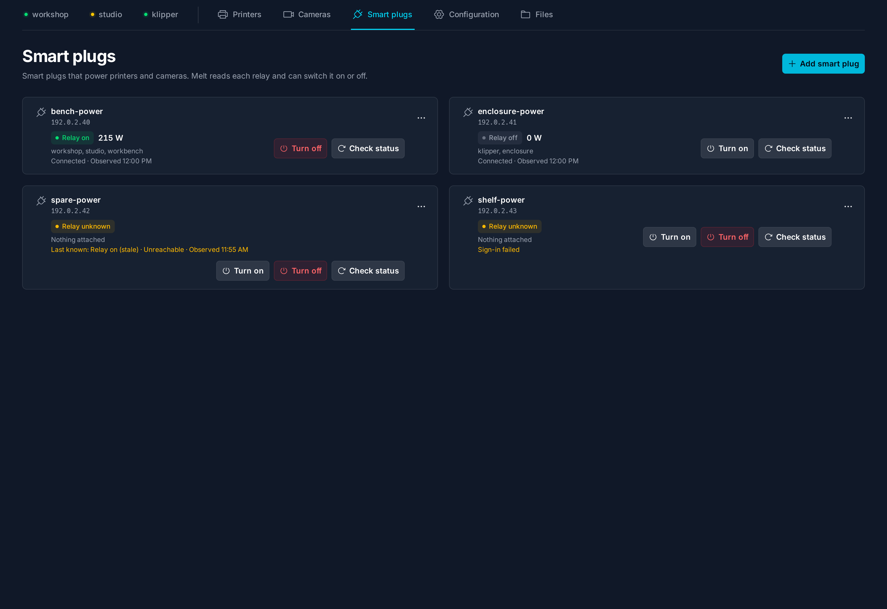

## Smart plug settings

Editing keeps the password blank (the saved one is retained) and shows the
attached printers and cameras.

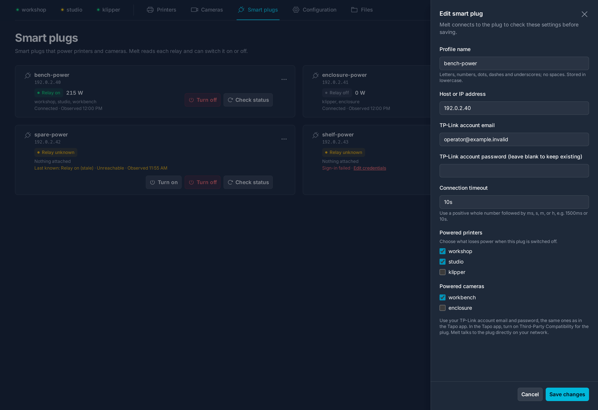

## Smart plug power-off confirmation

Turning off lists the printers and cameras that lose power and their activity.
The capture never confirms; it asserts no switch command was sent.

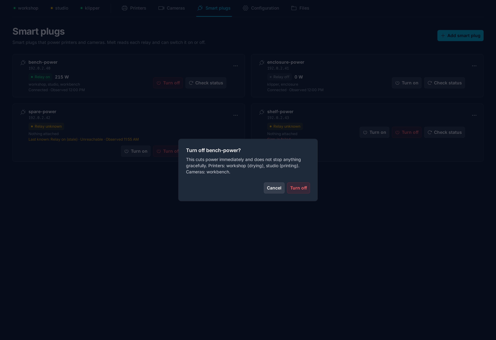

## Reproducing the captures

Install the UI dependencies as described in [development](development.md).
The screenshot helper additionally needs Python with `playwright` and `Pillow`,
the Playwright Chromium browser, and `ffmpeg` with the `libx264` encoder.

```sh
python3 -m pip install playwright Pillow
python3 -m playwright install chromium
make screenshots
```

`make screenshots` builds the current UI and runs
[`scripts/capture_screenshots.py`](../scripts/capture_screenshots.py).
The helper serves `ui/dist` on an ephemeral loopback port, supplies only the
checked-in [sample IPC data](../fixtures/screenshots/state.json), blocks
external browser requests and refuses unsupported backend actions. It never
opens a printer connection, reads user configuration or accesses a keychain.
WebRTC is unavailable in this capture environment; the actual WebCodecs path
is attempted and MJPEG remains its fallback. Before capturing, it checks
navigation across all six views, retained file search, shared theme/locale
changes and camera teardown when leaving the Cameras view.

To review files before replacing the repository images:

```sh
make ui-build
python3 scripts/capture_screenshots.py --output /tmp/melt-screenshots
```

The script fails if any `View` in `ui/src/app-types.ts` has no scenario, or
if the UI calls an IPC command the fixture bridge does not implement.

Visually inspect every view, check the recorded playback, and retain the
manifest alongside the images. Rebuild and recapture whenever UI source or
dependencies change.

## Required UI PR evidence

Every PR that changes visible UI must include freshly captured **Before**
and **After** images in its description. This includes changes to layout,
styling, text, assets, and interactive states, regardless of which source
files implement the change. Changes with no visible UI effect are exempt.
Agents must follow this procedure as required by [AGENTS.md](../AGENTS.md).

1. Identify the affected views and states. Use the existing capture helper
   and sanitized fixtures; extend its scenarios if they do not exercise the
   change. Never use real printer/camera data or credentials.
2. Capture **Before** from the merge-base of the PR head and its actual
   target branch, in a separate disposable checkout. Do not reset or switch
   the working checkout or reuse its `ui/dist`. Install the prerequisites
   above, then run from the baseline checkout:

   ```sh
   make ui-install ui-build
   python3 scripts/capture_screenshots.py --output /tmp/melt-pr-before
   ```

3. Capture **After** from the checkout containing the final changes:

   ```sh
   make ui-install ui-build
   python3 scripts/capture_screenshots.py --output /tmp/melt-pr-after
   ```

   Use unique output directories outside both checkouts for each PR. Keep
   the fixture scenario, viewport, theme, locale, and browser version
   consistent between captures. For a new view, capture its predecessor or
   entry point as the baseline and explain that no direct equivalent existed.
4. Inspect the relevant image pairs to confirm they show the intended change
   without unexpected errors or layout regressions. Keep each
   `capture-manifest.json` with its images and record the baseline commit and
   after source commit/hash in the PR description. Recapture after any
   subsequent edits that affect the visible UI.
5. Upload the relevant PNGs to GitHub using the agent's available attachment
   support and embed the returned image URLs under **Before** and **After**
   headings in the PR description, labeled by view/state. Preserve the rest
   of the description. A PR comment, local file path, artifact download link,
   or existing gallery image is not a substitute for these inline images.

If attachment tooling is unavailable, ask the author to drag the PNGs into
the PR description in GitHub's editor. If capture or upload fails, report
the exact blocker and keep the PR in draft until the evidence is attached.
Do not commit comparison images to the repository unless updating the
documentation gallery is part of the requested change.

This is a contribution requirement, not an automated CI gate. The synthetic
browser captures do not replace native desktop or live-hardware checks.
